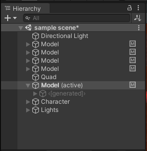
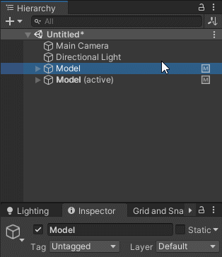
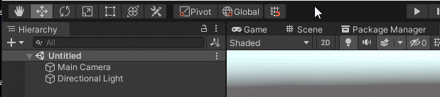
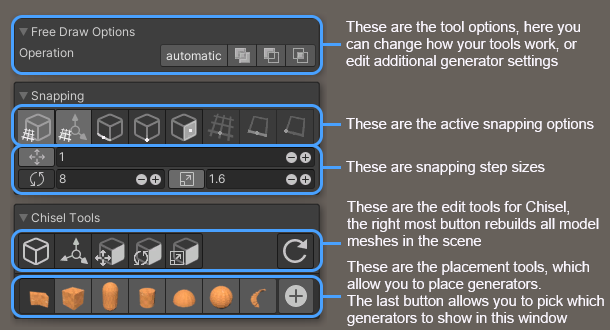
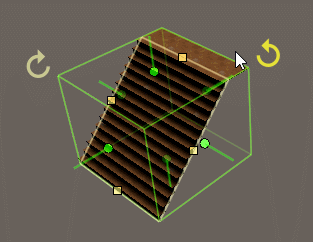
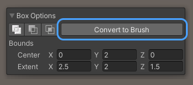
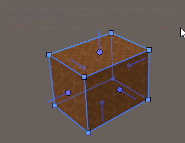
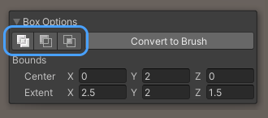
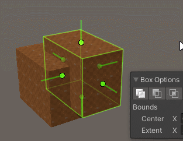

### Getting Started

In Chisel you build your level out of models, generators, brushes and composites. Each one is described in more detail on [the wiki](https://github.com/RadicalCSG/com.chisel/wiki).

### Models
At the root of your hierarchy you have the Chisel Model:

A model turns the generators and brushes under it into meshes. It creates and manages the MeshRenderers and
MeshColliders those meshes go on, so Chisel works with Unity's lightmapping, occlusion culling and navigation meshes.

The generated meshes are kept under the model's **<[generated]>** GameObject. You never need to edit them yourself.

A model is created for you when you create your first generator, and new generators go into the active model. If a
generator ends up outside a model, the scene's default model is added and the generated meshes become part of it.
You can also create a model yourself with **GameObject > Chisel > Create Model**.

### Creating generators

Select the create tool in the scene view's tool bar:

Pick a shape, then click and drag in the scene view to draw it, on the grid or on an existing surface. The create
tool's options are shown in an overlay in the scene view:

The create tool draws boxes, cylinders, capsules, hemispheres, spheres, linear and spiral stairs, and free drawn
shapes. Every generator, including the stadium, torus, revolved shape and pathed stairs, can also be created with
**GameObject > Chisel > Create Generators**.

### Generators

Generators create brushes for you, while keeping the context of what it is you're creating: stairs remain stairs that
you can edit and tweak by their step height and depth, instead of a pile of separate brushes.

A generator can be turned into plain brushes with the **Convert to Brush** (or **Convert to Brushes**) button in its
inspector. Once you convert a generator to brushes, you cannot turn it back into a generator.

See [Generators](https://github.com/RadicalCSG/com.chisel/wiki/Generators) on the wiki.

### Brushes

Brushes are the simplest shapes: convex shapes that you edit by moving, adding and removing their vertices, edges and
surfaces. You get brushes by converting a generator.

### Operations

Every generator, brush and composite has an operation:

* **Additive** adds its shape to the model
* **Subtractive** cuts its shape out of the shapes above it
* **Intersecting** keeps only the area its shape has in common with the shapes above it

You can also set the operation of the selection with **GameObject > Chisel > Set Operation To**.

See [Operations](https://github.com/RadicalCSG/com.chisel/wiki/Operations) on the wiki.

### Composites

Put generators and brushes under a **Composite** to combine them into one shape first, and then add, subtract or
intersect the whole shape, with the composite's own operation, with the shapes above it. This lets you build more
complicated shapes, such as a window frame with its hole, and use them as one.

Create one with **GameObject > Chisel > Create Composites**, or put the selection in one with
**GameObject > Chisel > Encapsulate selection in Composite**.

See [Hierarchical CSG](https://github.com/RadicalCSG/com.chisel/wiki/Hierarchical-CSG) on the wiki.
