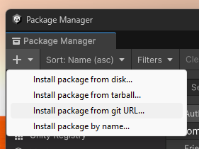
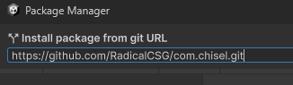

### Installation

Chisel requires **Unity 6.6 or newer**, and its materials are made for the **Universal Render Pipeline (URP)**, which
is installed along with it.

Go to **Window > Package Manager**.

In the package manager press the **+** and select **Install package from git URL**

---
In the textbox type in

https://github.com/RadicalCSG/com.chisel.git?path=/Installer~

And press enter. This installs the Chisel Installer, which installs Chisel and the packages it depends on, then
removes itself.

---

Chisel depends on [Custom Asset Metadata](https://github.com/RadicalCSG/CustomAssetMetadata), which is installed
from git too: the Package Manager doesn't install a package's dependencies from git by itself, which is why the
installer does. So git needs to be installed and on your path.

### Without the installer

Install these two git URLs the same way, in this order:

1. https://github.com/RadicalCSG/CustomAssetMetadata.git
2. https://github.com/RadicalCSG/com.chisel.git

### Updating from a version with Custom Asset Metadata inside it

Older versions of Chisel had Custom Asset Metadata inside them, as a git submodule. Install the Chisel Installer
as above: it installs Custom Asset Metadata and updates Chisel with it.

The first time you start up it might take some time, because Unity Burst compiles a lot of code.
This should only happen once.

### If the installation fails

* **"Filename too long"** (Windows): git can't write the dependencies inside a deep project folder. Allow long
  paths in git once, with `git config --global core.longpaths true`, or move the project to a shorter path, then
  install again.
* **"Cannot checkout repository"**: make sure git is installed and that `git` works in a command prompt; Unity uses
  it to download Chisel and its dependencies.

Then see [Getting Started](GETTING_STARTED.md).
