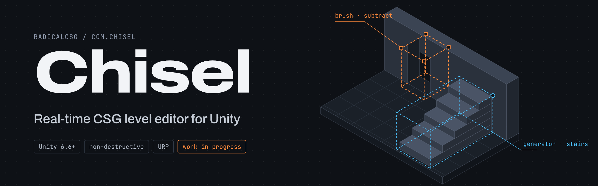
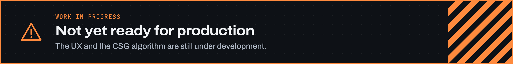

<p align="center">
  
</p>

<p align="center">
  <a href="https://unity.com/releases/editor"></a>
  
  <a href="LICENSE"></a>
  
  <a href="https://github.com/RadicalCSG/com.chisel/stargazers"></a>
  <a href="https://discord.gg/zttNkPQ"></a>
</p>

<p align="center">
  <a href="INSTALLATION.md">Installation</a> ·
  <a href="GETTING_STARTED.md">Getting started</a> ·
  <a href="https://github.com/RadicalCSG/com.chisel/wiki">Wiki</a> ·
  <a href="https://github.com/orgs/RadicalCSG/projects/1">Roadmap</a> ·
  <a href="#extensions">Extensions</a> ·
  <a href="http://www.youtube.com/watch?v=Iqmg4gblreo">GDC talk</a> ·
  <a href="https://discord.gg/zttNkPQ">Discord</a>
</p>

<p align="center">
  
</p>


## About

Chisel is a Unity extension for rapid, iterative, **non-destructive** level editing. Block out a level with brushes, carve it with subtractive shapes, refine it with generators and texture it with hotspots and decals — every operation stays live, so nothing is baked until you want it to be.

Every feature is documented in the [wiki](https://github.com/RadicalCSG/com.chisel/wiki).

## Features

### Surfaces & texturing

<table>
  <tr>
    <td width="33%"><b><a href="https://github.com/RadicalCSG/com.chisel/wiki/Hotspot-Mapping">Hotspot mapping</a></b><br>UVs come from the best-matching tile of a layout. Layout editor included.</td>
    <td width="33%"><b><a href="https://github.com/RadicalCSG/com.chisel/wiki/Decals">Decals</a></b><br>Project a material over or in place of surfaces. Omni-directional, skewed, with fade distances.</td>
    <td width="33%"><b><a href="https://github.com/RadicalCSG/com.chisel/wiki/Trim-Decals">Trim decals</a></b><br>Decals that wrap the edge between two surfaces and follow it as brushes change.</td>
  </tr>
  <tr>
    <td><b>Vertex painting</b><br>Paint directly onto CSG surfaces.</td>
    <td><b><a href="https://github.com/RadicalCSG/com.chisel/wiki/Double-Sided-Surfaces">Double-sided surfaces</a></b><br>A material can draw its surfaces from behind too.</td>
    <td><b><a href="https://github.com/RadicalCSG/com.chisel/wiki/Normal-Smoothing">Normal smoothing</a></b><br>Smooth shading across CSG surfaces.</td>
  </tr>
</table>

### Building geometry

<table>
  <tr>
    <td width="33%"><b><a href="https://github.com/RadicalCSG/com.chisel/wiki/Real-time-CSG">Real-time CSG</a></b><br>Exact geometry, generated in real time, without cracks where shapes meet.</td>
    <td width="33%"><b><a href="https://github.com/RadicalCSG/com.chisel/wiki/Operations">Add, remove, intersect</a></b><br>Fluid, interactive, non-destructive CSG operations.</td>
    <td width="33%"><b><a href="https://github.com/RadicalCSG/com.chisel/wiki/Generators">Generators</a></b><br>Higher-level shapes keep their context: stairs stay editable as stairs.</td>
  </tr>
  <tr>
    <td><b><a href="https://github.com/RadicalCSG/com.chisel/wiki/Hierarchical-CSG">Hierarchical CSG</a></b><br>Grouped brushes and generators act as one whole.</td>
    <td><b><a href="https://github.com/RadicalCSG/com.chisel/wiki/Brush-Contents">Brush contents</a></b><br>Solid, glass or water. Faces stay where different contents meet.</td>
    <td><b><a href="https://github.com/RadicalCSG/com.chisel/wiki/Subtractive-Workflow">Subtractive workflow</a></b><br>Start from solid space and carve rooms out of it.</td>
  </tr>
</table>

### Editing

<table>
  <tr>
    <td width="33%"><b><a href="https://github.com/RadicalCSG/com.chisel/wiki/Prefabs">Prefabs</a></b><br>Drop a window onto a wall and its hole comes with it.</td>
    <td width="33%"><b><a href="https://github.com/RadicalCSG/com.chisel/wiki/Drawing-2D-Shapes">2D shapes</a></b><br>Draw on CSG surfaces, bend lines into curves, extrude.</td>
    <td width="33%"><b>Forgiving brushes</b><br>Brushes stay visible and editable while their shape is invalid.</td>
  </tr>
  <tr>
    <td><b><a href="https://github.com/RadicalCSG/com.chisel/wiki/Snapping">Snapping</a></b><br>Snap the pivot or bounds of what you move to grid lines.</td>
    <td><b><a href="https://github.com/RadicalCSG/com.chisel/wiki/Grid">Rotatable grid</a></b><br>Move and rotate the grid to work at any angle.</td>
    <td><b><a href="https://github.com/RadicalCSG/com.chisel/wiki/Debug-Visualizations">Debug visualizations</a></b><br>See hidden, shadow-only, collider and CSG-discarded surfaces.</td>
  </tr>
</table>

### Output

Ordinary Unity meshes and colliders that work with light-mapping, occlusion culling and navigation meshes — split into a mesh per material and into [spatial chunks](https://github.com/RadicalCSG/com.chisel/wiki/Chunking).

## Getting started

Requires **Unity 6.6** or newer and the **Universal Render Pipeline** (URP).

1. Open <kbd>Window › Package Manager</kbd>
2. Click <kbd>+</kbd> and choose *Install package from git URL…*
3. Paste the URL below and press Enter.

```
https://github.com/RadicalCSG/com.chisel.git?path=/Installer~
```

This installs the Chisel Installer, which installs Chisel and the package it needs from git, then removes itself.
Git has to be installed. The first start-up takes a while: Burst compiles a lot of code. This only happens once.

[Read the getting started guide →](GETTING_STARTED.md)

## Extensions

| Extension | Repository |
|---|---|
| Source Engine 2006 map importer | [Henry00IS/Chisel.Import.Source](https://github.com/Henry00IS/Chisel.Import.Source) |
| ↳ Decals on models that aren't Chisel geometry | [Henry00IS/Chisel.Decals](https://github.com/Henry00IS/Chisel.Decals) |
| ↳ VPK import support for the importer | [nukeandbeans/com.chisel.import.source.vpktools](https://github.com/nukeandbeans/com.chisel.import.source.vpktools) |
| Quake 1 importer | [Quixotic7/Chisel.Import.Quake1](https://github.com/Quixotic7/Chisel.Import.Quake1) |

## How it works

The core algorithm is explained in the GDC 2020 talk *Geometry in Milliseconds: Real-Time Constructive Solid Geometry*.

[](http://www.youtube.com/watch?v=Iqmg4gblreo)

## Community

- Questions, showcases and dev chat: [join the Discord server](https://discord.gg/zttNkPQ)
- Want to contribute? Start with a [good first issue](https://github.com/RadicalCSG/Chisel/labels/good%20first%20issue)

## Reporting problems

Found a case where Chisel fails? [Open an issue](https://github.com/RadicalCSG/com.chisel/issues/new/choose) — a scene that reproduces it helps a lot.

## License

Chisel is released under the [MIT license](LICENSE).
