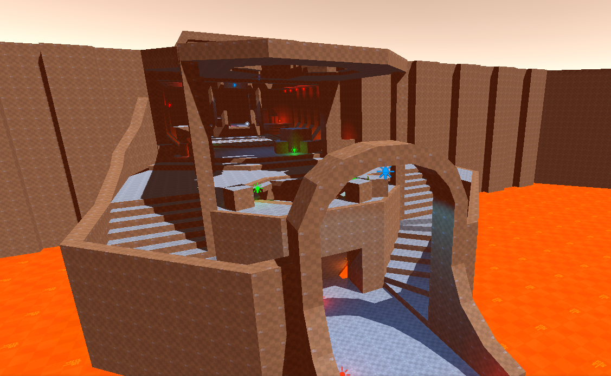

# [Chisel](https://github.com/RadicalCSG/com.chisel/wiki) (WIP)

Chisel is an extension for **Unity** that allows for _rapid_, iterative, **non destructive** level editing!

---
* You can find [installation instructions here](INSTALLATION.md)
* [Click here for information on how to get started](GETTING_STARTED.md)
* Every feature is explained on [the wiki](https://github.com/RadicalCSG/com.chisel/wiki)
* Want to help out? Read [how to contribute](CONTRIBUTING.md), and see [what is planned](https://github.com/orgs/RadicalCSG/projects/1)
*  If you have questions be sure to ask in the discord! **[Click here to join the official Discord server!](https://discord.gg/zttNkPQ)**

---

Note:
- Chisel *requires Unity 6.6 or newer*, and the *Universal Render Pipeline (URP)*
- UX is *still under development*
- Feature set is *still under development*
- It is *not yet* ready for production, but please feel free to try it out, or better yet, help out!

---

## Features (incomplete)

Building geometry
* [Constructive Solid Geometry](https://github.com/RadicalCSG/com.chisel/wiki/Real-time-CSG) that generates geometry in real-time, exactly, without cracks where shapes meet
* [Add, remove and intersect geometry](https://github.com/RadicalCSG/com.chisel/wiki/Operations) to your level using CSG, for fluid, interactive, non destructive workflows
* Higher level ["generators"](https://github.com/RadicalCSG/com.chisel/wiki/Generators) that create more complicated geometry to perform CSG with, while retaining context of what it is you're creating (if you create stairs, these will remain stairs that you can edit and tweak)
* [Hierarchical Constructive Solid Geometry](https://github.com/RadicalCSG/com.chisel/wiki/Hierarchical-CSG): generators and brushes grouped in a composite act as one whole, to perform CSG on other objects with
* [Subtractive Workflow](https://github.com/RadicalCSG/com.chisel/wiki/Subtractive-Workflow)
* Works well with [prefabs](https://github.com/RadicalCSG/com.chisel/wiki/Prefabs): drag and drop windows onto walls including their holes
* [Draw 2D shapes](https://github.com/RadicalCSG/com.chisel/wiki/Drawing-2D-Shapes) (possible to turn straight lines into curves) on existing CSG surfaces and extrude them
* [Brush contents](https://github.com/RadicalCSG/com.chisel/wiki/Brush-Contents): solid, glass, water; faces stay where different contents meet

Precision
* [Snapping](https://github.com/RadicalCSG/com.chisel/wiki/Snapping) to grid lines, of the pivot or bounds of what you move
* [Rotatable & movable grid](https://github.com/RadicalCSG/com.chisel/wiki/Grid)

Surfaces and texturing
* [Normal smoothing](https://github.com/RadicalCSG/com.chisel/wiki/Normal-Smoothing)
* [Double sided surfaces](https://github.com/RadicalCSG/com.chisel/wiki/Double-Sided-Surfaces): a material can make its surfaces drawn from behind too
* [Hotspot mapping](https://github.com/RadicalCSG/com.chisel/wiki/Hotspot-Mapping): surfaces take their texture coordinates from the best matching tile of a layout (borders, repeats, shaped tiles and trim sheets), with a layout editor
* [Decals](https://github.com/RadicalCSG/com.chisel/wiki/Decals): boxes that project a material onto the surfaces they reach, drawn over them or replacing them, their image repeated in x and y, from the whole texture or an image in a trim sheet
* [Trim decals](https://github.com/RadicalCSG/com.chisel/wiki/Trim-Decals): a decal on the edge between two surfaces, the lower half of its image on one and the upper half on the other (or mirrored), stretched, repeated or fitted along the edge or one image placed on it, running round corners, its image from the whole texture or a trim sheet, following the edge when either brush changes; placed by picking an edge in the scene view, or on every edge where two materials meet

Output
* Ordinary Unity meshes and colliders, that work with Unity's lightmapping, occlusion culling and navigation meshes
* [Chunking](https://github.com/RadicalCSG/com.chisel/wiki/Chunking): a model's output is split into a mesh per material, and divided into chunks of space, for better occlusion and culling handling
* [Debug visualizations](https://github.com/RadicalCSG/com.chisel/wiki/Debug-Visualizations) of user-hidden, shadow-only, shadow-casting, shadow-receiving, collider and discarded (removed by the CSG) surfaces

## Planned Features (incomplete, and in random order)

See [the project](https://github.com/orgs/RadicalCSG/projects/1) for everything that is planned.
* Decals, still to do:
  * [Trim decals placed where the materials of two brushes meet](https://github.com/RadicalCSG/com.chisel/issues/32) (now only within one brush)
  * [Omni directional decals](https://github.com/RadicalCSG/com.chisel/issues/33)
  * [Skewed decals](https://github.com/RadicalCSG/com.chisel/issues/34)
  * [Fade distances](https://github.com/RadicalCSG/com.chisel/issues/35)
* [Snapping to vertices, edges and surfaces of other geometry](https://github.com/RadicalCSG/com.chisel/issues/42)
* [Brushes that stay visible and editable while their shape is invalid](https://github.com/RadicalCSG/com.chisel/issues/12)
* [Vertex Painting](https://github.com/RadicalCSG/com.chisel/issues/36)
* [Extrusion from existing surface](https://github.com/RadicalCSG/com.chisel/issues/37)
* [2D shape editor](https://github.com/RadicalCSG/com.chisel/issues/38)
* [Grid Objects](https://github.com/RadicalCSG/com.chisel/issues/39)
* [Clip Tool](https://github.com/RadicalCSG/com.chisel/issues/40)
* [Node Based Generators](https://github.com/RadicalCSG/com.chisel/issues/41) for easy procedural content generation

## Extensions
* [Source Engine 2006 Map Importer for Chisel Editor](https://github.com/Henry00IS/Chisel.Import.Source)
  * [Decal support for importer](https://github.com/Henry00IS/Chisel.Decals)
  * [VPK import support for importer](https://github.com/nukeandbeans/com.chisel.import.source.vpktools)
* [Quake1 Importer](https://github.com/Quixotic7/Chisel.Import.Quake1)

## Reporting problems

If you find any failure cases, please [open an issue](https://github.com/RadicalCSG/com.chisel/issues/new/choose), and if possible provide us with a reproducible scene so we can more easily fix it!

## License

Chisel is available under the [MIT license](LICENSE).

---
The core technology is based on the algorithm explained in [this GDC 2020 talk](http://www.youtube.com/watch?v=Iqmg4gblreo)

